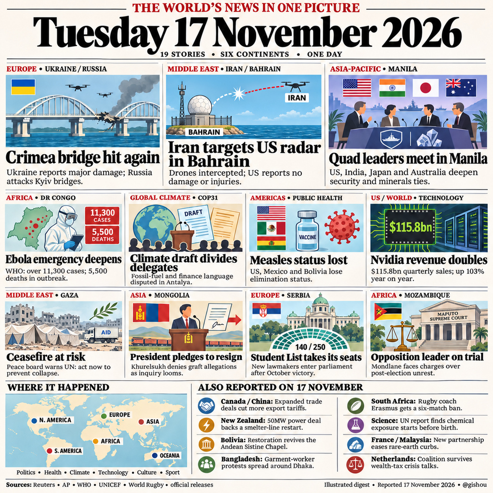

# The World on 17 November 2026

An illustrated newspaper digest of **19 stories across six continents**, made
for the [make.fun news-image bounty](https://make.fun/bounty/news-image-20261117).
Reporting was gathered and checked before the artwork was generated. The
illustrations are editorial diagrams, not documentary photographs.

The page covers the Crimean bridge attacks, Iran's drone attack targeting US
radar in Bahrain, the Manila Quad summit, Ebola, COP31, measles, Nvidia's
earnings and other political, scientific, cultural and sports reporting.
[SOURCES.md](SOURCES.md) lists every story, dated reporting and qualifications.

Run `python main.py` with Python 3.13 in the competition sandbox. It uses only
the standard library and copies the bundled 1024×1024 JPEG unchanged to
`/output/entry.png`; no network, model calls or external assets are needed.
The contest accepts JPEG bytes under that required output filename.

Validated in two isolated, network-disabled Python 3.13.17 containers: both
outputs were byte-identical at 734,577 bytes.

